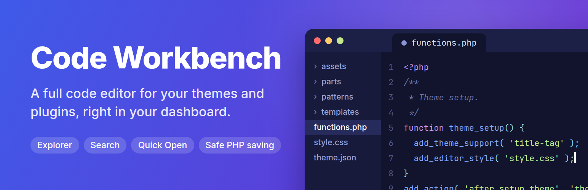
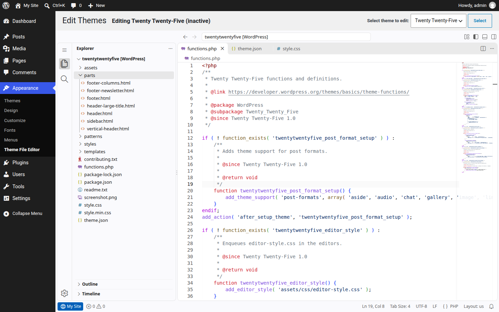
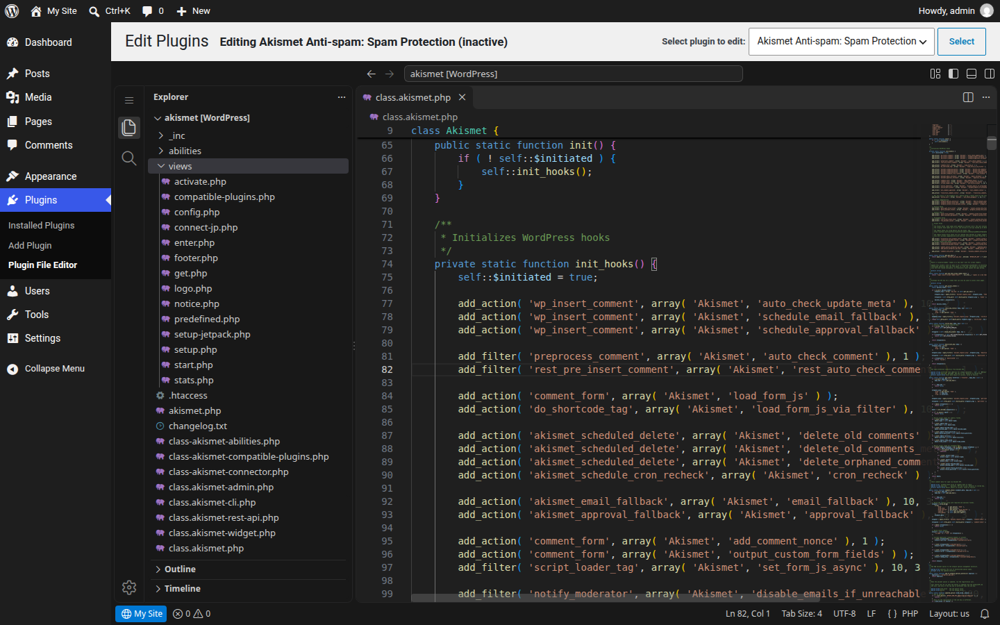
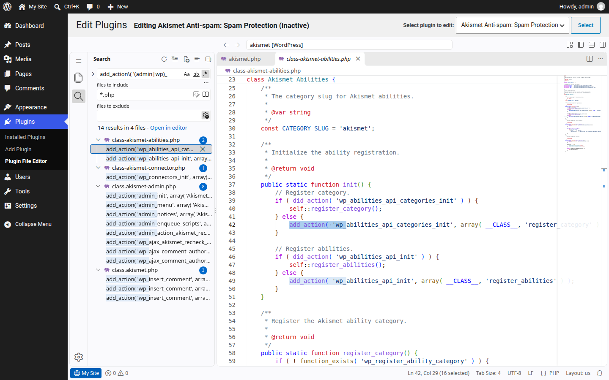
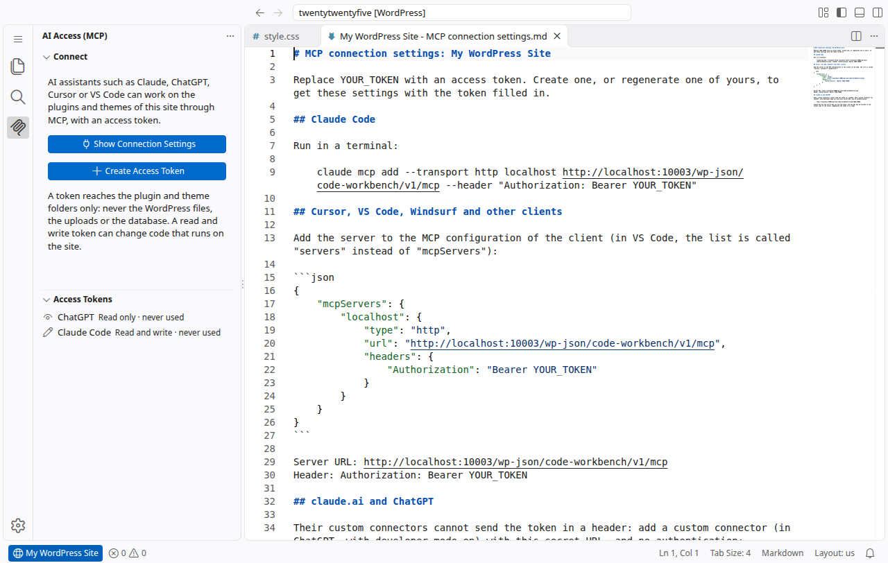
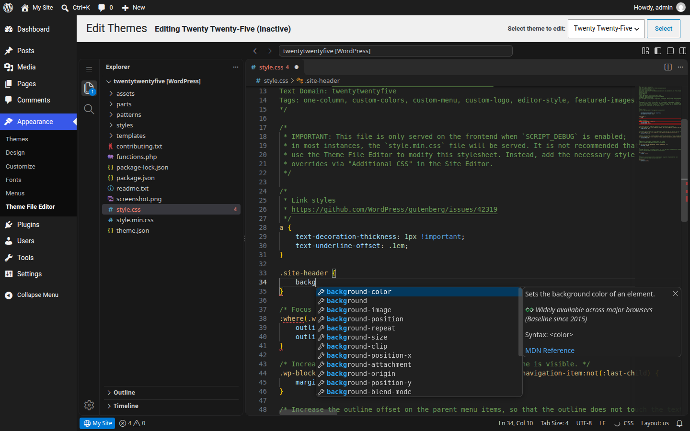
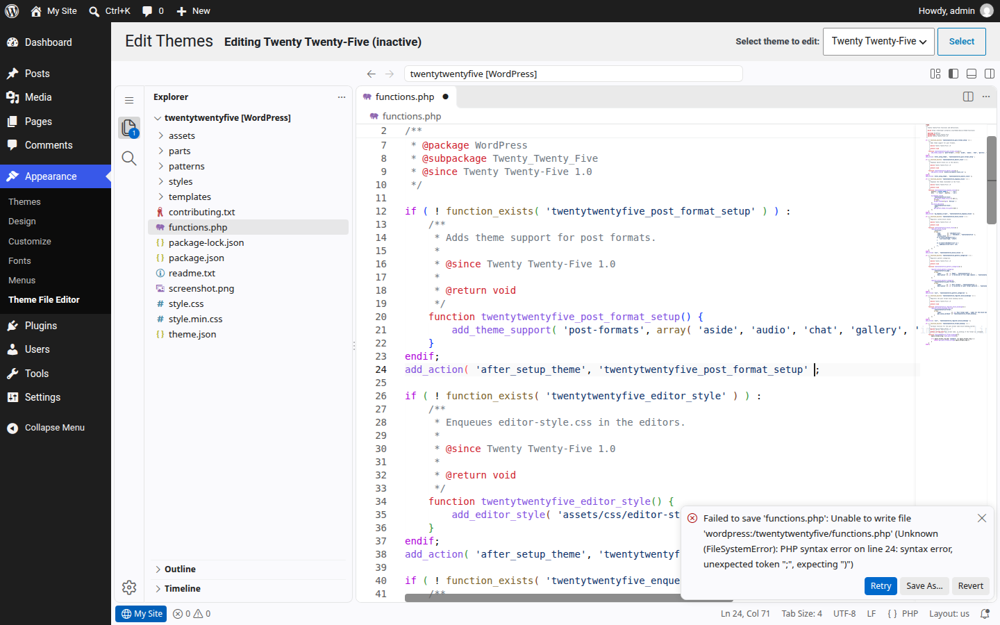

# Code Workbench



A WordPress plugin that replaces the **Theme File Editor** and the **Plugin File Editor** with VS Code for the Web, running inside the WordPress admin, and lets AI assistants (Claude, ChatGPT, Cursor, VS Code…) work on plugin and theme files through [MCP](https://modelcontextprotocol.io).

The editor is built from the MIT licensed source of VS Code ([Code - OSS](https://github.com/microsoft/vscode)) and ships inside the plugin: it downloads nothing and needs no external service.

## Features

- **VS Code in the admin**: file explorer, tabs, split editors, minimap, multiple cursors, command palette, Quick Open (Ctrl+P) and search with regular expressions and include / exclude patterns.
- **Languages**: syntax highlighting for PHP, HTML, CSS, SCSS, Less, JavaScript, TypeScript, JSON, Markdown, XML, YAML, SQL and shell scripts; completions and validation for CSS, SCSS, Less and JSON; Emmet.
- **Scoped**: the editor opens on the selected theme or plugin folder and cannot reach anything else (other plugins, WordPress core, `wp-config.php`, uploads).
- **Safe saves**: files are written on Ctrl+S only. A PHP syntax error is never saved, and on the active theme and active plugins a change, a delete or a rename that breaks the site is reverted.
- **AI access (MCP)**: read only or read and write access tokens, created, regenerated and revoked from the editor, for any assistant that supports remote MCP servers.
- **Updates from GitHub**: new releases show up and install like the updates of any other plugin.

| | |
| --- | --- |
|  |  |
|  |  |
|  |  |

## Requirements

- WordPress 6.4 or later (tested up to 7.2), PHP 7.4 or later.
- Users need the capabilities of the core editors (`edit_themes`, `edit_plugins`): administrators, or super admins on multisite. When `DISALLOW_FILE_EDIT` or `DISALLOW_FILE_MODS` is set, the editors and the access tokens are disabled.

## Installation

1. Download `code-workbench-<version>.zip` from the [Releases](https://github.com/KinG-InFeT/code-workbench/releases) page. Do not use the "Source code" archives: they lack the bundled editor, which is built, not versioned (see [Building from source](#building-from-source)).
2. In WordPress, go to **Plugins → Add New Plugin → Upload Plugin**, upload the zip and activate the plugin.

Updates then come from the GitHub releases: they appear in **Dashboard → Updates** and on the Plugins screen, and can be installed with one click or automatically (auto-updates). A zip can also be uploaded again the same way: WordPress offers to replace the installed version.

The plugin contacts one outside service: the GitHub API, at most every 12 hours, to read the latest release. It sends no information about the site.

## Usage

### Editing files

Open **Appearance → Theme File Editor** (**Tools → Theme File Editor** with a block theme) or **Plugins → Plugin File Editor**, and pick a theme or plugin in the menu at the top right. The screens keep their core URLs, so `theme-editor.php?theme=<theme>&file=<file>` and `plugin-editor.php?plugin=<plugin>&file=<file>` open a given file.

- Save with **Ctrl+S**. There is no auto save: half-typed code never reaches the site.
- A PHP file with a syntax error is not saved; the error and its line are shown.
- On the active theme and active plugins, WordPress loads the site after every PHP save, as the core editor does, and the change is reverted if it causes a fatal error. Deleting or renaming a PHP file or a folder is checked the same way.

### AI assistants (MCP)

In the editor, click the **AI Access (MCP)** icon in the activity bar on the left, next to Explorer and Search. Its **Connect** section has the *Show Connection Settings* and *Create Access Token* buttons, and **Access Tokens** lists the tokens. The same actions are in the Command Palette under *Code Workbench:*.

1. **Create Access Token**: give it a name (the assistant and the device that use it) and choose its access:
   - **Read only**: browse, search and read files, and load the public pages of the site;
   - **Read and write**: also create, edit, upload, move and delete files, and load pages logged in as you.
2. A document opens with the token and the settings of the assistants. **Copy them right away**: the token is shown only once.
3. Add the server to your assistant:
   - **Claude Code**: `claude mcp add --transport http <name> https://example.com/wp-json/code-workbench/v1/mcp --header "Authorization: Bearer <token>"`
   - **Cursor, VS Code, Windsurf** and other clients configured with JSON: the server URL with an `Authorization: Bearer <token>` header (VS Code calls the list `servers` instead of `mcpServers`).
   - **claude.ai and ChatGPT**: their custom connectors cannot send a header. Add a custom connector (in ChatGPT, with developer mode on) with the secret URL `https://example.com/wp-json/code-workbench/v1/mcp/<token>` and no authentication.

The view lists the tokens with their access, owner and last use. Revoke a token you no longer use, and regenerate it if its settings or its secret URL may have leaked: the assistants using it must then be set up again. Only the owner can regenerate a token; any user of the editors can revoke one.

Tools of the server:

| Tool | Access | What it does |
| --- | --- | --- |
| `list_projects` | read | Plugins and themes, with slug, version and whether they are active. |
| `list_files` | read | A folder, or every file below it (recursive, or matching a glob). |
| `read_file` | read | Lines of a text file, or an image (PNG, JPEG, GIF, WebP). |
| `search` | read | Text or regular expression search, answering `path:line: text`. |
| `fetch_page` | read | Loads a page of the site: status, time, redirects, title, PHP errors shown in the page, and its text or HTML. With a read and write token, it can load the page logged in as the token owner. |
| `write_file` | write | Creates or overwrites a file (text, or base64 for binary files), creating missing folders. |
| `edit_file` | write | Replaces an exact text in a file. |
| `create_folder`, `delete`, `move` | write | Folder and file management. |

Every change goes through the same checks as the editor.

Security notes:

- A token acts as the user who created it and stops working if that user can no longer edit plugins and themes.
- A read and write token can change code that runs on the site: give it only to assistants you trust, and prefer read only tokens.
- Tokens reach the plugin and theme folders only, and `fetch_page` loads pages of the site itself, never other hosts.
- The secret URL can end up in the access logs of the web server. A security plugin that handles every `Authorization: Bearer` header (JWT authentication, for instance) can block the header form; the URL form still works.

## Building from source

The repository does not version the VS Code build (`vscode/`) nor the release files (`dist/`): build them with the scripts in `bin/`.

Tools: git, rsync, zip and [nvm](https://github.com/nvm-sh/nvm). The Node.js major must match the `.nvmrc` of the VS Code tag; the pnpm version VS Code pins runs through `npx`.

```bash
git clone https://github.com/KinG-InFeT/code-workbench.git && cd code-workbench
nvm install 24          # Node.js major of the VS Code tag's .nvmrc
bin/build-vscode.sh     # builds vscode/<CODE_WORKBENCH_VSCODE>
bin/package.sh          # writes dist/code-workbench-<version>.zip
```

For development, symlink the repository into a test site: `ln -s "$PWD" /path/to/wp-content/plugins/code-workbench`.

### `bin/build-vscode.sh`

Builds VS Code for the Web from the Code - OSS tag named by `CODE_WORKBENCH_VSCODE` (`code-workbench.php`). The Microsoft download (`web-standalone`) cannot be used: its license forbids redistributing it.

1. Clones the tag into `~/.cache/code-workbench/vscode-<version>` (or the folder given as argument) and reuses it on the next runs.
2. Stops if the running Node.js major differs from the tag's `.nvmrc`.
3. Deletes the built-in extensions not in its `EXTENSIONS` list (the workbench lists every extension it was built with, so they go before the build), drops them from the fixed lists of the build (`build/lib/extensions.ts`, `build/gulpfile.extensions.ts`), and renames grammar files with spaces or brackets in their names.
4. Installs the dependencies with pnpm, frozen lockfile and no install scripts (they only compile native modules of the desktop app), in the three install roots: the root workspace, `build/` and `remote/`.
5. Runs `gulp vscode-web-min` and replaces `vscode/` with the trimmed result.

What the build keeps: the grammars of the languages listed in [Features](#features), the CSS and JSON language servers, Emmet, the default color themes and the Seti file icons, and the runtime modules the editor loads (`vscode-textmate`, `vscode-oniguruma`, `jschardet`, `@vscode/iconv-lite-umd`). What it leaves out: the JavaScript / TypeScript and HTML language servers, Markdown preview, Git, notebooks, Copilot and AI features, the image preview, source maps and native modules. The result is about 40 MB on disk and 11 MB zipped.

A run takes a few minutes, and the checkout takes about 3 GB. `~/.cache/code-workbench` can be deleted at any time. Build from a path without UUID-like folder names: npm masks them as `***`, and the extension packager then finds no files for the grammar-only extensions.

### `bin/package.sh`

Checks that the versions match (plugin header, `CODE_WORKBENCH_VERSION`, `Stable tag` of `readme.txt`) and that `vscode/<version>/` is built, then writes `dist/code-workbench/` (the plugin without development files and hidden files, with `extension/` renamed `extension-<version>/`, see [How it works](#how-it-works)) and `dist/code-workbench-<version>.zip`.

## Repository layout

| Path | Role |
| --- | --- |
| `code-workbench.php` | Bootstrap: versions (`CODE_WORKBENCH_VERSION`, `CODE_WORKBENCH_VSCODE`), includes, hooks. |
| `includes/class-code-workbench-admin.php` | Editor screens, select menu, workbench document. |
| `includes/class-code-workbench-files.php` | File REST API: scope and path checks, safe PHP saves, search. |
| `includes/class-code-workbench-mcp.php` | MCP server, access tokens and their REST routes. |
| `includes/class-code-workbench-updater.php` | Updates from the GitHub releases. |
| `uninstall.php` | Deletes the access tokens, the only data the plugin stores. |
| `assets/` | Workbench start-up (`workbench.js`), hidden views (`workbench.css`), screen layout (`admin.css`). |
| `extension/` | Built-in VS Code extension: the `wordpress:` file system, Quick Open, search and the AI Access (MCP) side bar. |
| `vscode/<version>/` | Bundled VS Code (generated, with its `LICENSE.txt` and `ThirdPartyNotices.txt`). |
| `bin/` | Build scripts (not part of the plugin zip). |
| `.github/images/` | Banner, icon and screenshots of this README. |
| `readme.txt` | User documentation and changelog, in the WordPress plugin readme format. |

## How it works

```
theme-editor.php / plugin-editor.php            (admin screen, core URL)
 ├─ select menu → reloads the screen on another theme / plugin
 └─ <iframe ?code_workbench_frame=1>             (workbench document)
     ├─ vscode/<version>/out/...                 (VS Code workbench)
     ├─ assets/workbench.js                      (create() on the workspace folder)
     └─ extension/                               ("wordpress:" file system, AI Access view)
          └─ fetch → /wp-json/code-workbench/v1/* (cookie + REST nonce)

AI assistant ── POST /wp-json/code-workbench/v1/mcp (access token)
               └─ rest_do_request() → the same file routes
```

- **Core takeover.** `load-theme-editor.php` / `load-plugin-editor.php` render the screen and end the request before core renders its own editor. The defaults follow core: the active theme with `style.css`, or the first plugin with its main file. Core's loopback requests (`wp_scrape_key`) still reach the real screens.
- **Iframe.** The workbench runs in a full height iframe, so the admin CSS does not leak into it. Its document prints its own styles and scripts; admin notices are removed from these screens.
- **No server process.** VS Code for the Web runs in the browser. `extension/` is a plain JavaScript web extension, loaded as a built-in one, with a `FileSystemProvider`, a file search provider (Quick Open) and a text search provider for the `wordpress:` scheme. The extension host runs on the site's origin (the Code - OSS product has no `webEndpointUrlTemplate`), so it calls the REST API with the admin cookies and the nonce handed over by the `codeWorkbench.config` command; an expired nonce is refreshed through `admin-ajax.php?action=rest-nonce`.
- **Explicit saves.** `files.autoSave` is `off`, so files are written on Ctrl+S.
- **Trimmed UI.** `assets/workbench.css` hides Source Control, Run and Debug, Extensions, Accounts and the chat status item, matched by their icon or entry ids (`source-control-view-icon`, `run-view-icon`, `extensions-view-icon`, `accounts-view-bar-icon`, `chat.statusBarEntry`). They cannot be removed from the build, which depends on their services.
- **Fewer requests.** Each file operation boots WordPress, and VS Code probes many paths that do not exist (`.vscode/tasks.json`, `pyproject.toml`…). The extension answers paths outside the folder, and paths missing from a folder listing read in the last 30 seconds, without a request. Only absence is answered this way, and any change clears the listings.
- **Updates.** The `Update URI` header points to this repository, so WordPress asks the `update_plugins_github.com` filter for new versions instead of wordpress.org (which also keeps it from offering a different plugin with the same slug). `includes/class-code-workbench-updater.php` answers with the latest release of the GitHub API (cached for 12 hours, one hour after a failure) and its `code-workbench-<version>.zip` asset, and fills "View details" (`plugins_api`) with the release notes.
- **Extension folder per version.** The zip ships `extension/` as `extension-<version>/`, so a browser never runs a cached extension of the previous version after an update. A `?ver=` query cannot be used: VS Code ties an extension to the URL of its folder. A development checkout keeps `extension/`.

### File REST API (`code-workbench/v1`)

Every route takes the scope: `type` (`plugin` | `theme`) and `item` (the plugin folder, the file of a single file plugin, or the theme stylesheet). Paths start with the item, e.g. `/akismet/akismet.php`.

| Route | Method | Purpose |
| --- | --- | --- |
| `stat`, `readdir`, `read` | GET | Reads. `read` streams the raw file (up to 20 MB) without loading it in PHP memory. |
| `write` | POST | Raw body as the file content; `create`, `overwrite` flags. |
| `mkdir`, `delete`, `rename` | POST | Changes. |
| `find` | POST | Every file under a folder, for Quick Open. |
| `search` | POST | Text search: regex, case, whole word, include and exclude globs. Each file is matched whole (a regex can span lines); UTF-8 files are matched as text. |

Errors use the codes `not_found`, `exists`, `not_dir`, `is_dir`, `forbidden`, `invalid_path`, `php_error`, `invalid_regex`, `too_large`, `failed`, mapped by the extension to VS Code `FileSystemError`s.

**Isolation.** A plugin must be installed and a theme must exist. Path segments `.`, `..`, backslashes and NUL bytes are rejected, and anything outside the item does not exist. The item folder itself cannot be deleted or renamed. A single file plugin is a virtual folder holding only its file, which can be edited but not created, renamed or deleted. A folder holding several plugins is checked against the active one. Symlinks inside the item are followed (search and Quick Open follow each one once); deleting a symlinked folder removes the link, not its target. A user who can edit one plugin can edit them all, as in core: the scope keeps a session on the selected item, it is not a permission boundary.

### Safe PHP changes

1. Every PHP file is syntax checked (`token_get_all( $code, TOKEN_PARSE )`) before it is written.
2. It is then saved through `wp_edit_theme_plugin_file()`, the function behind the core editors: on an active plugin or theme, core loads wp-admin and the home page and rolls the change back on a fatal error. Files core leaves out of its editable list (`vendor/`, `node_modules/`…) are let in for that save through the `plugin_files_exclusions` / `theme_scandir_exclusions` filters, and a new PHP file is created empty and then saved the same way, since a plugin may load every file of a folder.
3. Core's loopback needs a wp-admin auth cookie, which REST requests do not carry: the save hands it one for the current session, or for a short session created for the request (MCP calls have none).
4. Deleting or renaming a PHP file or a folder of an active plugin or theme first moves it aside (`.code-workbench-<random>` in the same folder), then saves the item's main file again, unchanged, through core to run the same check. On failure everything is put back.
5. The PHP files involved are dropped from OPcache before they are deleted or moved, otherwise the old code would keep running and fool the check.

### MCP server

`/wp-json/code-workbench/v1/mcp` speaks Streamable HTTP with JSON answers only: one JSON-RPC message per POST, no event stream, no session (`GET` and `DELETE` answer 405, notifications 202). It implements `initialize`, `ping`, `tools/list` and `tools/call`, for protocol versions `2025-11-25` back to `2024-11-05`. Tool failures come back as results flagged `isError`.

- **Tokens** look like `cw_<id><secret>` (8 + 40 characters). Only their SHA-256 hash is stored, in the option `code_workbench_mcp_tokens` (a network option on multisite), with name, access, owner, creation and last use (written at most once a minute).
- A token is read from `Authorization: Bearer` or from the URL (`/mcp/<token>`). The request then runs as the token owner, and every tool goes through the capability check and the file routes above (`rest_do_request()`), so the same validation, isolation and safe saves apply. A read token does not see the write tools.
- `fetch_page` only reaches the host and port of the site, at every redirect (followed by hand, up to five). Logged in pages use a session created for the call and destroyed after it.
- The editor manages the tokens through `mcp-tokens` routes (cookie and nonce, `edit_plugins` or `edit_themes`): `GET` lists them without secrets, `POST` creates one, `POST mcp-tokens/<id>/regenerate` gives a new secret (owner only), `DELETE mcp-tokens/<id>` revokes one. The UI is an activity bar container with the `$(mcp)` codicon: a **Connect** view whose tree is always empty, so VS Code always shows its welcome content (text and buttons), and the **Access Tokens** tree with inline actions. A new token opens in a read only virtual document of the extension (`code-workbench-mcp:` scheme), kept in memory only, so it never lands in the browser's backup of unsaved files. There is no webview: views, input boxes and dialogs are native VS Code UI.

## Maintenance

### Updating VS Code

VS Code ships a stable version every week; the [update API](https://update.code.visualstudio.com/api/update/linux-x64/stable/latest) gives the latest (`productVersion`).

1. Read the Node.js version in the tag's `.nvmrc` and `nvm install` it.
2. Set `CODE_WORKBENCH_VSCODE` in `code-workbench.php` to the tag, and update the version and link in the "Open source" section of `readme.txt`.
3. Run `bin/build-vscode.sh`. It writes `vscode/<new version>/` and removes the old folder; the new folder name keeps browsers from mixing cached files of two versions.
4. Check the editor on a theme and on a plugin: opening, saving, the PHP syntax error notice, Quick Open, search, the AI Access view; no request leaving the site in the browser's network tab; the hidden views still hidden; the zip size (`bin/package.sh` prints it).

If the build fails, compare the new source with the edits of the script: the `EXTENSIONS` list, the filtered build lists, the install roots and the runtime `MODULES`.

### Releasing a version

1. Raise the version in the plugin header, in `CODE_WORKBENCH_VERSION` and in the `Stable tag` of `readme.txt`; add a Changelog entry to `readme.txt`, and update `Tested up to` when a new WordPress version is out.
2. Run `bin/package.sh`.
3. Check the plugin in `dist/code-workbench` with [Plugin Check](https://wordpress.org/plugins/plugin-check/), that folder installed in a test site: `wp plugin check code-workbench --include-experimental --exclude-checks=plugin_updater` must report nothing. The excluded check forbids update checkers, a rule of the wordpress.org directory only.
4. Commit, tag and publish the GitHub release with the zip. The updater relies on two names: the tag is `v<version>` and the asset is `code-workbench-<version>.zip`, as `bin/package.sh` writes it. The release notes appear in "View details" on the sites.

```bash
git commit -am "Release 1.2.0" && git tag v1.2.0 && git push origin master v1.2.0
gh release create v1.2.0 dist/code-workbench-1.2.0.zip --title "Code Workbench 1.2.0" --notes-file notes.md
```

## Limitations

- No terminal, debugger, tasks or extension marketplace, as in any VS Code for the Web built from Code - OSS. PHP, HTML and JavaScript get highlighting, snippets and Emmet, without language servers.
- The hidden views are hidden, not removed: their shortcuts and the Command Palette still open them, empty.
- No webviews: VS Code runs them on a dedicated hostname a WordPress site cannot provide. Images open as binary files.
- JSON schemas are not downloaded, so `theme.json` and `block.json` are not validated against `schemas.wp.org`.
- Changes made on disk by other means are not watched; VS Code still detects them on save, through the modification time.
- Text search skips binary files and files over 1 MB and stops at 5,000 matches; Quick Open lists up to 50,000 files. Regular expressions are PCRE, not JavaScript.
- The MCP server has no OAuth (assistants use access tokens) and cannot take screenshots: `fetch_page` returns the text or HTML of a page.
- A request that dies while a delete or rename is checked (a PHP timeout) can leave the file or folder under its hidden `.code-workbench-<random>` name; rename it back.
- The plugin files must be served from the site's own origin: exclude `wp-content/plugins/code-workbench/` from CDN or optimization plugins that rewrite plugin URLs.

## License

Copyright 2026 Vincenzo Luongo. Licensed under the [Apache License, Version 2.0](LICENSE).

The bundled VS Code build keeps its MIT license (`vscode/<version>/LICENSE.txt`, with `ThirdPartyNotices.txt`). Visual Studio Code is a trademark of Microsoft Corporation; Code Workbench is not affiliated with or endorsed by Microsoft.
